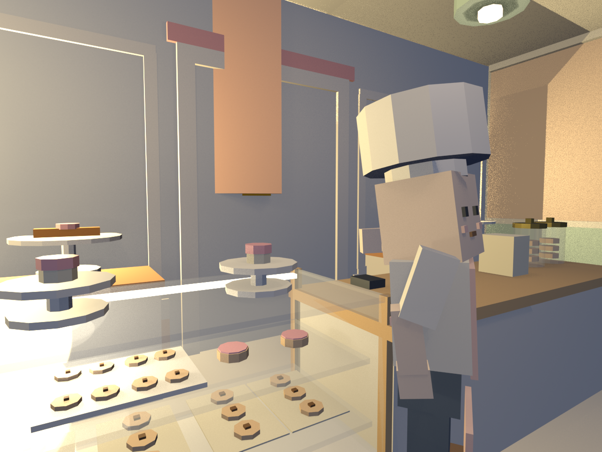

# 🍪 Stylized 3D Cookie Shop — Blender & Three.js

A charming low-poly stylized **"Cookie Shop"** nighttime urban street scene built in Blender 5.3 and rendered interactively on the web using Three.js and WebGL.


---

## ✨ Features

- **Storefront & Architecture:**
  - Pastel mint-green (`#9CE2D3`) and peach (`#FFD1B3`) two-story storefront with ornate white cornice moldings.
  - Giant extruded 3D chocolate chip cookie mounted above the entrance with warm accent lighting.
  - Striped pastel pink-and-white fabric awning over the doorway.
  - Deep bay display windows showcasing tiered shelves with pastries, cookies, and breads.
  - Back door and cozy string-light festoon lighting in the rear patio.

- **Fully Modeled & Animated Interior:**
  - Wooden plank flooring and pastel wood-paneled interior walls.
  - Front wooden service counter with illuminated glass pastry display case.
  - POS station with cash register, card reader, and tip jar.
  - Wall chalkboard menu and baking supply shelves.
  - Glowing baking oven (`#FF6600`) and multi-tier cooling rack with trays of cookies.
  - **Animated Baker Character (`Pelayan`):** 240-frame looping animation carrying trays and tending to pastries.

- **Nighttime Urban Streetscape:**
  - Flanking multi-story urban apartment buildings with warm illuminated window grids.
  - Neighboring cozy bookstore and boutique shop facades.
  - Modular tiled stone sidewalk with parked bicycle, streetlamps, outdoor cafe table & chairs, and chalk A-frame sign.
  - Road with zebra crossings, parked taxi and compact car.
  - Night sky with glowing crescent moon and twinkling star particles.

- **Web 3D Interactive Viewer (Three.js):**
  - **OrbitControls:** Smooth rotate (Left Click), pan (Right Click), and zoom (Mouse Scroll).
  - **Preset Camera Switcher:** Smooth tween transitions between City Street View, Front Storefront, Interior Shop, and Baker close-up.
  - **Animation Toggle:** Play / pause character and scene animations.
  - **Standalone Offline Viewer (`cookie_shop_standalone.html`):** Single self-contained HTML file with embedded 3D assets, no web server required.

---

## 📸 Screenshots

| Urban Street View | Animated Interior View |
| :---: | :---: |
|  |  |

---

## 🚀 How to Run

### Method 1: Standalone Offline (Recommended — No Server Needed)
Double-click `cookie_shop_standalone.html` or run `open_viewer.bat`.  
This file contains the embedded 3D model and runs directly in any modern web browser (Chrome, Edge, Firefox, Safari).

### Method 2: Local Web Server
Run `start_server.bat` (or use any static file server):
```bash
# Using Python
python -m http.server 8080
```
Then open [http://localhost:8080/index.html](http://localhost:8080/index.html) in your browser.

---

## 📁 Project Structure

```
├── cookie_shop_scene.glb          # Optimized low-poly 3D binary model (2.2 MB)
├── index.html                     # Main Three.js Web viewer (loads external GLB)
├── cookie_shop_standalone.html    # Standalone offline viewer (base64 embedded GLB)
├── open_viewer.bat                # 1-click batch launcher for standalone viewer
├── start_server.bat               # 1-click local HTTP server launcher
├── cookie_shop_urban_street.blend # Master Blender 5.3 project file
├── export_clean_glb.py            # Blender script to export clean GLB without light overexposure
├── generate_standalone_viewer.py  # Python script to compile standalone HTML viewer
├── build_full_urban_scene.py      # Procedural urban street expansion script
├── build_animated_interior.py     # Procedural interior architecture & baker rigging script
└── README.md                      # Project documentation
```

---

## 🛠️ Built With

- **[Blender 5.3](https://www.blender.org/)** — 3D modeling, rigging, procedural animation, and material shading (optimized for EEVEE).
- **[Three.js (r128)](https://threejs.org/)** — WebGL 3D rendering engine, OrbitControls, and GLTFLoader.
- **[tween.js](https://github.com/tweenjs/tween.js/)** — Smooth camera position and target transitions.
- **Python / bpy** — Automated procedural geometry, scene composition, and glTF export pipelines.

---

## 👤 Author

- **GitHub:** [@tovankamil](https://github.com/tovankamil)
- **Repository:** [https://github.com/tovankamil/blender-threejs](https://github.com/tovankamil/blender-threejs)
